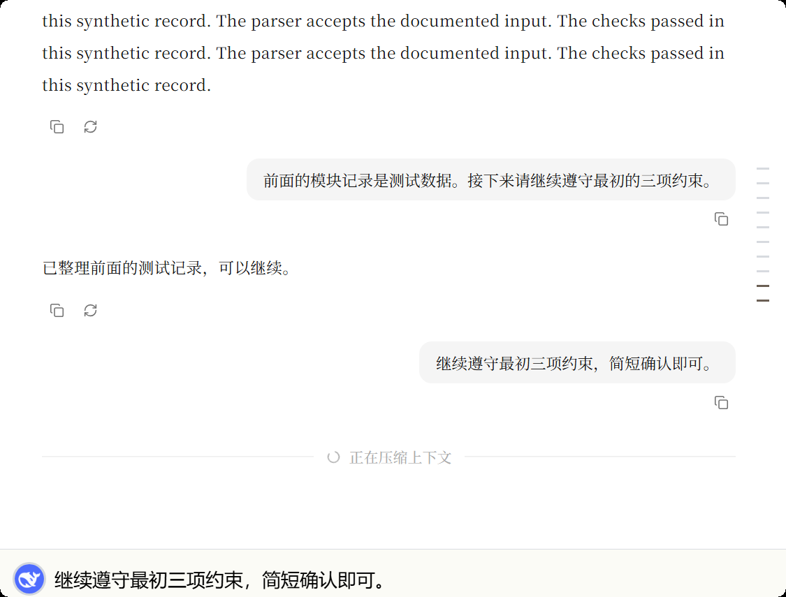
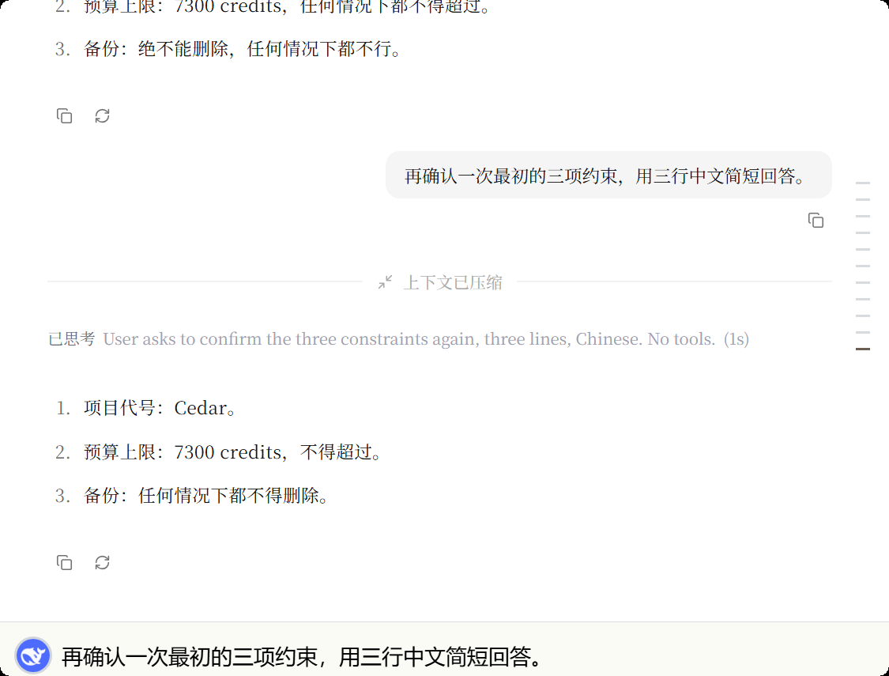

# Context management visual evidence

Captured on Windows on 2026-11-08 from the running native `TouchAI.exe` window, using Win32 `PrintWindow`. The maintainer reviewed these visuals before requesting submission.

The existing `target-pr730/debug` executable loaded the worktree's Vue frontend from Vite. It was not rebuilt from this branch. An isolated profile used only synthetic conversation history, the authorized Magpie `ai/deepseek-v4.1-flash` provider, and a deliberately reduced 16,000-token test window. Native database/HTTP, the executor, summarization and rendering were live; neither of these screenshots injects a compaction state or model response. The viewport was 750 CSS pixels wide at DPR 1.5.

The captures predate synchronization with the main branch's window/overlay changes. They demonstrate the reviewed compaction appearance against the cached host; they are not packaged E2E evidence for the synchronized PR head.

## Compacting

This captures the final loading treatment: Source Han Serif medium, subdued neutral text, half-pixel rules, and the ordinary answer loader's space retained while its dots are hidden. The real request entered compaction, but this follow-up capture script timed out after 240 seconds waiting for completion. This image proves the loading presentation, not a successful completed turn or a latency bound.

## Completed

This separate successful request shows the final completed treatment and preservation of the synthetic Cedar / 7,300 credits / never delete backups constraints. It predates the loading-space fix, which does not change completed-state styling. The initial native smoke run independently observed both status transitions and a successful persisted answer.

## Other evidence and limits

- A controlled transition check in the native WebView reproduced the loading-space regression at 420px and 750px. Before the fix, the waiting area changed from 44px to 90px when compaction completed; after the fix both states were 90px. These geometry checks used injected test states and are separate from the live captures above.
- Native painted-font inspection confirmed `Source-Han-Serif-SC-VF-Medium`, weight 500. Switching the actual language setting changed the label between Chinese and English.
- Rendered component checks covered both window widths, overflow, loading/completed states, reduced motion and increased contrast. Full Storybook and packaged desktop visual baselines remain outstanding.
- No provider credentials, local databases or runtime logs are included in these assets.
