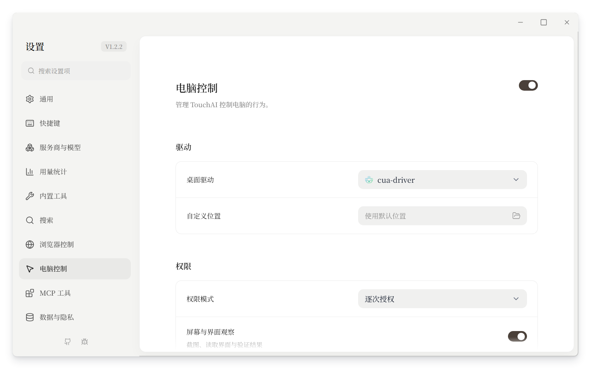

# 电脑控制设置调研 — RFC #111 / PR #730

## 仅前台执行时显示反馈，2026-11-09

Given 电脑控制任务已开始，When 后台观察、读取配置、排队或等待模型，Then 不显示辉光、
顶部提示和操作光标。When 实际执行前台键鼠、激活或调整窗口，Then 显示反馈；调用完成、
失败或取消后收起，任务身份与驱动会话继续保留，下一次操作无需重建会话。
Given 多个任务，When 一个前台操作结束，Then 不清除其他仍在执行的操作；迟到的光标
不能重新打开已收起的反馈。前台执行期间按 Esc 仍可停止电脑控制。

显示时机由原生执行队列持有，开始排队不算占用前台。cua 依据实际工具与 delivery 参数，
agent-desktop 依据 headed 模式和操作类别；截图、剪贴板与配置不触发反馈。
不透明的脚本与轨迹回放按整个调用保守显示；当前接入没有逐子动作通知，不能保证在脚本内部
每个等待间隙精确收起。该反馈不改变权限或操作交付方式。

呼吸仍为 5.2 秒周期，低点从 82% 调至 65%，最高保持 100%；只改变辉光透明度，
提示文字、光标保持稳定，减少动态效果时常亮。沿用 token 与已有叠层，不新增设置。

## 对齐设置页配色，2026-11-09

Given 用户在浏览器、通用与电脑控制设置之间切换，When 查看设置名称、说明和分组，
Then 电脑控制直接使用 SettingsRow 的默认黑色标签、灰色说明以及既有标题样式，
不再用偏棕色的文字覆盖；分隔线采用中性边框色。控件继续使用相同的现有组件。
本次仅移除页面颜色覆盖，不新增颜色或组件；以原生窗口前后截图和实际计算颜色核对，
不增加只断言类名的实现镜像测试。

## 保留操作叠层的白字，2026-11-09

Given 电脑控制任务正在运行，When 设置页名称恢复默认黑色，Then 已选定的 C 版操作
提示仍为石墨底白字，Esc 提示、光标描边和会话标签仍清晰可见。
Rebase 带入了 main 对未使用 token 的清理，但叠层仍引用 text-inverse 与 border-strong，
导致文字颜色与光标阴影失效。恢复这两个被叠层使用的角色值，不改设置页默认配色。
回归覆盖 token 解析结果，并在原生叠层读取文字、Esc、光标标签颜色及光标阴影。

## 自定义驱动位置，2026-11-09

Given 未指定自定义目录，When 打开设置或重新启动，Then “自定义位置”留空，不显示或
持久化内部默认路径，驱动运行时根据当前应用目录拼装默认路径。
Given 已选择自定义目录，When 清除选择，Then 校验并迁回默认目录后删除目录偏好；
迁移或持久化失败则保留原选择与驱动文件。中英文均支持选择和恢复默认，不改变控件宽度。

## 适配远端 main，2026-11-09

基于 `e9d1dd59` 的启动能力门、内联浮层和窗口几何接口保留原有电脑控制行为。
Given 设置页按需加载，When 打开电脑控制页，Then 使用现有分区预加载机制。
Given 主窗口重新加载，When 新渲染器启动，Then 同时重置窗口渲染会话并清理旧辉光。
Given 用户手动缩小过会话窗口，When 电脑控制审批面板出现，Then 监视器宿主和普通
原生窗口均按审批内容重新测量，审批内容不会被旧的手动高度裁切。该回归迁入新版
`useSearchWindowResize` 测试，继续使用系统边界模拟与可观察的最终面板高度。

## 真实案例失败回归，2026-11-09

Given 同一电脑控制会话，When 从普通调用切换到完整权限后再切回，Then 同一驱动
运行时仍能读取配置，不出现 `session_unavailable`。实际 0.38.0 DLL 已复现普通调用
成功后完整权限调用失败：两条调用路径给同一公开会话绑定了不同的 transport owner。
修复保持身份一致，不更改权限校验、权限模式或驱动的用户同意要求。

Given 未允许前台操作，When 准备连接已经运行的浏览器且未显式要求启动浏览器，Then
传递 `allow_launch:false`；显式请求启动或前台动作仍拒绝。模型工具描述包含当前权限。
Given 原生 `launch_app`，When 使用公共工具同名字段 `app`，Then 适配为驱动要求的
`name`；同时提供不同名称则明确报冲突，不猜测目标。

## 驱动体积与工具活动，2026-11-09

Given 驱动选择列表，When 查看已安装的驱动，Then 第二行在版本旁显示当前安装版本
所有文件的实际大小，包含主程序、辅助程序和安装记录；未安装或大小未知时不显示。
仅读取该版本目录下文件的元数据，不下载、不扫描用户目录，不计入运行轨迹与缓存。

Given 电脑控制工具活动，When 操作成功或失败，Then 行内仅显示操作名称、已有目标
摘要与耗时，不追加“完成／失败”，颜色与浏览器工具行一致。实际工具结果、错误记录
和模型收到的内容保持不变；等待授权与运行中状态仍明确显示。

## 控件对齐与目录选择，2026-11-09

验收：Given 电脑控制设置页，When 查看驱动、权限模式、截图清晰度和保存位置，Then
下拉框与路径输入框左右边缘及宽度一致，路径旁的文件夹按钮独立对齐；最小和默认窗口
宽度、中英文下均不溢出。沿用 SettingsRow、CustomSelect、Input 和 Button。

Given 默认二进制目录 `assets/bin`，When 查看或选择驱动位置，Then 界面仅显示所选
父目录，实际安装在其 `computer-use-drivers/<driver>/<version>` 下。新默认位置复用
公共二进制目录；旧默认安装校验复制后迁移，既有自定义安装继续可用，不触碰同目录的
RTK、其他工具或用户文件。目录键仅保存自定义安装根路径，默认目录不持久化，不更改数据库结构。

Given 页面有多个开关，When 某项保存尚未完成，Then 仅该项防止重复操作，其他开关
仍可独立修改；并发修改不能覆盖彼此，单项失败后恢复操作并显示错误。总开关成功关闭、
驱动缺失及驱动删除/迁移期间仍保留相应的不可用状态。

调研日期：2026-11-08。通过 Exa Search 定位官方资料，再用 Exa Contents
实时抓取五篇配置文档，逐条确认抓取成功。本次没有安装或实测竞品界面；
TouchAI 的兼容判断另以本机 cua-driver 0.38.0、agent-desktop 1.2.0 实际工具
schema、当前适配器及固定版本源码核对，不把上游 main 的能力直接当成已接入能力。

## 其他产品提供什么

| 产品                                                                                                             | 官方文档中的设置或能力                                                                      | 对 TouchAI 的参考价值                                                                                                                               |
| ---------------------------------------------------------------------------------------------------------------- | ------------------------------------------------------------------------------------------- | --------------------------------------------------------------------------------------------------------------------------------------------------- |
| [UI-TARS Desktop 设置](https://github.com/bytedance/UI-TARS-desktop/blob/main/docs/setting.md)                   | 模型配置和可用性检测；单轮最大步数；每轮操作后的等待时间；浏览器搜索引擎；报告导出/上传设置 | “检测是否可用”值得借鉴。步数和等待属于任务执行，模型配置继续复用已有供应商页面。文档的等待默认值为 1000 ms，不能据此给所有操作增加固定延迟。        |
| [Claude Cowork 电脑控制](https://support.claude.com/en/articles/14128542-let-claude-use-your-computer-in-cowork) | 总开关；按应用授权及应用阻止列表；macOS 15+ 的后台操作与 Full control 选择；随时停止        | 授权和控制方式有产品价值，但应放在权限/行为区域。后台模式有明确系统前提，不能从 macOS 的描述推导 Windows 同样不抢焦点。                             |
| [Power Automate Desktop](https://learn.microsoft.com/en-us/power-automate/desktop-flows/console)                 | 暂停/继续和停止快捷键；通知/监控窗口；任务超时；失败截图；无人值守运行的屏幕分辨率          | 停止快捷键、失败诊断比暴露大量底层参数更有用。其超时、分辨率有任务类型、账户和版本条件，不是所有桌面动作的全局设置。                                |
| [Power Automate 画中画](https://learn.microsoft.com/en-us/power-automate/desktop-flows/run-desktop-flows-pip)    | 子会话、虚拟桌面预览；View only 和 Always on top                                            | 是独立执行环境的建设方向，Windows 版本/权限有要求；不能等价成当前本机驱动的一个后台开关。                                                           |
| [agent-desktop 配置](https://agent-browser.dev/desktop/configuration)                                            | CLI 参数设置 headed、会话、轨迹、条件等待及超时；独立状态目录；status/permissions 检测      | 它没有图形设置页，也没有配置文件。状态检测、恢复运行和条件等待有参考价值；CLI 参数应由适配器承接，不能直接平铺给用户。                              |
| [Cua 本机/远程指南](https://cua.ai/docs/cua-driver/guides/vms-and-remote)                                        | 权限状态、doctor；VM、SSH、交互桌面守护进程                                                 | 可参考运行诊断与目标环境。其 [Sandbox](https://cua.ai/docs/cua-sdk/reference/python/sandbox) 是隔离机器，不能与已经接入的本机 cua-driver 混为一谈。 |

## 当前驱动实际能承接什么

- **运行检查：两者都有基础。** cua 提供 `check_permissions`、`get_config`；agent
  提供 `desktop_status`、`desktop_permissions`。TouchAI 已有状态读取与关闭运行时
  的服务，可以组合成检查/恢复入口。Windows cua 的 `prompt` 明确被忽略；检查
  不应假装弹出不存在的系统授权。恢复只能重建运行时，不能承诺修复所有系统权限问题。
- **截图清晰度：cua 已实现。** 现有 `maxImageDimension` 已保存并下发，可从“行为”
  移到“驱动”，无需增加一个重复设置。agent 的截图 schema 没有同等缩放参数；若要
  统一，需先完成截图缩放及坐标映射验证，不能只显示一个无效控件。
- **目标屏幕：agent 有入口，cua 当前接口不对等。** 实际 agent schema 包含
  `desktop_list_displays` 和 `desktop_screenshot.screen`；cua 的 `get_desktop_state`
  没有对应的屏幕选择参数。截图选屏也不自动约束全部输入，落地前需验证多屏、DPI、
  窗口归属及坐标范围，不能把它宣传成应用访问限制。
- **识别模式：不应新增。** cua 0.38.0 的 `set_config.capture_mode` 明确标为
  `DEPRECATED and ignored`，始终返回 UIA 树和截图，设置 ax/vision 不会改变行为。
- **光标样式/节奏：cua 有原生参数。** schema 包含徽标、动效和移动节奏；`steady`
  的描述是每次移动至少 600 ms。这个下限是否进入 TouchAI 的动作耗时关键路径需要
  单独测量，尚不能作为已证实的慢速根因。优先验证合理默认值，不把所有动效参数
  做成独立设置。我们自己的反馈层与原生光标也需要避免重复配置。
- **画中画：不能按稳定隔离能力展示。** cua 的 `experimental_pip` 标为实验功能且
  下次重启生效；agent 的 headed/headless 是输入方式，不是另一个隔离桌面。
- **自动更新：需要兼容流程。** 目前下载由固定版本/hash 验证，更新检查不会自动
  执行未经核验的版本。自动升级应先有版本验证和回退能力，不能只增加开关。

## 建议的设置组织

“驱动”近期保持两类内容即可：

1. **桌面驱动**：复用现有下拉；标识和版本仍在驱动选择中。检查、重启、更新、
   删除都针对具体驱动，通过现有操作入口承载。
2. **截图清晰度**：移动已有设置，只在具备实际支持的驱动下可用；不重复保留在行为区。

下一批更值得实现的能力是 **停止快捷键**、**用户接管时暂停**、**失败时保存诊断**。
分别归到快捷键/行为/现有轨迹设置，复用已有取消和记录基础。用户接管需要跨平台区分
人工输入和自动化输入；失败记录需要明确记录范围、保留方式和容量，不能先加空开关。
停止会取消未完成的操作，已经完成的外部效果不会回滚。

多屏目标、远程或隔离环境是后续功能：有明确能力与实测之后再呈现。驱动区域的
密度应由实际能力决定，不建议复制权限模式、前台操作、轨迹路径或模型配置来填满。

## 本轮落实与验证

2026-11-08 验收：已配置电脑控制时，打开内置工具中的对应条目，只显示日志；
切换中英文后，名称和一句话摘要随语言更新，不展示模型操作指南。
配置继续由独立的电脑控制设置页管理。

已移除“暂无可用驱动，请先下载并安装。”独立提示行。无驱动时保留驱动选择入口，
权限及行为设置保留原值并禁用；删除确认/执行/刷新期间禁用全部页面控件。
这里的新增设置均为调研建议，本轮没有添加未实现的开关或更改数据库结构。

稳定布局、已加载 DLL 卸载及测试结果见 [驱动集成记录](computer-use-drivers.md)。
调研原始结果和本机 schema 存在会话缓存的 `resume1108-settings-research-*.json`
及 `resume1108-settings-driver-capabilities.json`。

## 驱动标识，2026-11-08

驱动下拉选项和选中值显示随应用打包的本地 SVG；未安装选项仍可通过标识识别，
无选中驱动时保留原占位文字。复用 `CustomSelect.iconSrc`，按用户最新反馈移除状态绿点。
这是纯视觉调整，按测试指南的布局例外不新增单元测试；验证已有设置与下拉测试及原生窗口。

- cua-driver：来自 [Cua 官方品牌图标](https://github.com/trycua/cua/blob/main/docs/public/img/cua-logo-accent.svg)，保留图形路径和渐变。
- agent-desktop：采用其 [官方文档分享图](https://github.com/vercel-labs/agent-desktop/blob/v1.2.0/apps/docs/app/%5Blang%5D/desktop/og/og-image.tsx) 使用的 Vercel 三角标识；保留路径并增加留白以适配现有下拉图标圆角。

验证：设置页与下拉组件共 64 项测试通过，应用类型检查、针对性 ESLint 和 Prettier 检查通过。
原生窗口在 1120×700、920×560 下显示正常；两种图标均成功解码，切换驱动后选中标识同步变化，
测试结束恢复 cua-driver。全量 PR/WDIO 检查未在此次纯视觉调整中重跑。

## 目录与内置工具入口验收，2026-11-08

- 移除 logo 上的状态圆点，保留驱动标识和已有下载/更新/删除操作。
- 内置工具列表中的 ComputerUse 显示为“电脑控制”或“Computer control”；摘要为
  “观察屏幕并操作桌面应用”或“Observe the screen and control desktop apps”。
  模型调用所需的协议说明继续由工具定义提供，设置列表不再显示那段长说明。
- 对应条目只有“调用日志 / Call logs”，配置仍在独立的电脑控制页面。切换语言时，
  名称、摘要、页签、目录按钮及设置标题即时更新。
- 驱动位置选择复用现有 `SettingsRow`、`Input`、`Button` 和原生目录选择器；无驱动
  时仍可更改位置，选择与迁移过程中禁用页面，取消或失败后恢复。
- 269 项前端定向用例通过（含修正后的 49 项服务与页签复测）；应用与测试类型检查、
  针对性 ESLint、Prettier、`git diff --check` 通过。55 项原生用例及原生 debug 构建通过。
- 原生窗口实际验证中英文切换、仅日志页签、无状态点，以及 1120×700、920×560
  无横向溢出。实际卸载并重新下载 agent-desktop 自动选中 npm 国内镜像，约 7 秒完成
  下载、启动和工具发现；loading 的 CSS animation 为持续 `spin`，过程页面保持禁用。
- 两种驱动在已加载状态下迁移约 9.7 秒，迁移与重启后分别发现 61 / 67 个原生工具；
  已恢复默认存储根目录和 cua-driver。Windows 占用的旧 DLL 在后续重启后完成清理。

本轮验证限于 Windows 与上述定向场景；未重跑完整 PR、WDIO、跨平台运行和正式
P50/P95 性能预算。目录迁移的耗时不是模型任务或常见电脑操作的性能结论。

## 多会话光标与停止提示验收，2026-11-08

PR #730 / RFC #111 的后续验收场景：

- Given 两个会话正在控制电脑，When 各自移动光标、其中一个完成，Then 保留两个
  独立位置和会话标识，只移除已完成会话，另一会话的提示和辉光继续显示。
- Given 电脑控制正在执行或等待下一轮模型，When 用户在任意应用按下真实 Escape，
  Then 取消所有当前电脑控制任务及排队动作，迟到结果不能重新显示光标或继续输入；
  驱动为关闭菜单而发送的合成 Escape 不应停止整个任务。
- Given 两个会话操作共享桌面，When 同时输入，Then 前台动作整段排队，批量输入
  不被另一会话打断；观察可并行，驱动的会话引用相互隔离。
- Given 任一驱动，When 显示操作反馈，Then 使用 TouchAI 统一光标与顶部停止提示，
  不抢焦点、不拦截鼠标、不进入驱动截图，中英文均可读。

参考入口：[Best Designs on X — cursor](https://bestdesignsonx.com/search/cursor/)、
[Emil Kowalski 的 agent 光标演示](https://bestdesignsonx.com/emilkowalski/status/2108531407786242389)、
[toast 参考](https://bestdesignsonx.com/search/toast/)。只借鉴清晰轮廓、小型会话标记和
紧凑状态条，外观使用项目已有语义 token；不复制站点的光标或品牌素材。

约束：多个可视光标不等于多个独立系统鼠标。Windows 共享桌面的前台输入和焦点
仍是单一资源。agent-desktop MCP 的 session/agent-id 是进程启动参数，必须按会话
隔离运行时，不能把未知 session 字段塞进每个工具参数。

顶部状态条同时参考了 [Benji Taylor 的紧凑通知演示](https://bestdesignsonx.com/benjitaylor/status/2069168413306667353)。
停止键复用已安装的全局快捷键插件；Windows 为区分驱动注入键，使用已安装 windows
crate 的低级键盘钩子，只检查 Escape 与 injected 标志，不收集或记录输入内容。

补充验收：agent-desktop 的语义 focus/type 不一定移动系统鼠标。反馈必须取目标的
最近观察的 bounds；没有观察到的位置时保留最后位置，不把用户鼠标位置冒充该会话操作。
批量失败时不得把尚未执行的后续目标显示为完成位置。

实现与结果：

- 默认使用 TouchAI 的 Lucide 指针（32 CSS px）、白色轮廓和会话色标，cua 原生光标
  关闭后仍读取其会话位置；agent-desktop 从本会话的观察结果定位语义目标，物理移动
  在实际执行期间采样。不是多个操作系统鼠标，也不会把等待队列中的会话绑定到当前
  系统鼠标。语义目标位置缓存上限 2048、有效期 60 秒，不新增模型轮次或逐动作读取。
- agent-desktop 各活动使用独立 MCP 进程、session/agent-id 和临时状态目录；结束后
  清理。cua 相同公开会话名按任务隔离；模型回传驱动返回的会话 ID 时继续原会话，
  回归测试先复现了错误开启第二会话，再验证修复。
- 顶部显示“TouchAI 正在操作您的电脑 按 Esc 停止”，各部分以留白分隔。原生窗口实测
  等待 2.2 秒后仍可见、不抢焦点；结束一个会话保留另一会话的位置和身份，全部结束
  后隐藏，迟到事件不能重新显示。这里使用实际 Tauri 窗口运行仓库的 E2E helper。
- 原生中止实测：一个 10 秒批次执行期间、另一个批次排队，停止后分别返回 cancelled
  和 cancelled before execution；69 ms 内反馈清空，后续旧活动调用被拒绝。真实硬件
  Escape 未由自动化模拟；Windows 钩子的人工/注入 Escape 区分有单测。
- 补充原生清理验收：没有前端停止监听时，停止也应释放 MCP 会话及临时目录；
  已在原生层统一释放，避免前端失联后仍累积进程和会话槽位。
- 204 项前端定向测试通过；修正返回会话 ID 后，相关 54 项再次通过。61 项原生测试
  通过，包含真实 cua DLL 和固定版本 agent-desktop 安装包。应用/测试类型检查、
  针对性 lint/format、原生 debug 构建通过，已启动新构建。

实际操作的限制和失败必须与反馈层的通过分开：

| 场景                        | 观察结果                                                                                           | 归属/状态                                                                |
| --------------------------- | -------------------------------------------------------------------------------------------------- | ------------------------------------------------------------------------ |
| 两个 cua 会话移动           | 独立位置、原生光标关闭，TouchAI 反馈按 DPI 正确换算                                                | 通过                                                                     |
| 两个 agent 会话操作不同窗口 | 分别显示记事本与 Magpie 的目标；输出快照不多带 bounds，窗口列表不出现反馈窗口                      | 反馈通过                                                                 |
| agent 前台 focus + type     | 记事本输入成功；Magpie 一次在 focus 返回 `Target window did not become foreground`，未发出后续输入 | 上游前台激活失败，仍未解决                                               |
| agent 后续单独 focus        | 记事本 `delivered_verified`；Magpie `delivered_unverified`                                         | 后者不能算可靠完成                                                       |
| cua 双窗口批量输入          | 记事本成功；Magpie 的首次批次在 type 步骤失败；确认输入框为空后单独重试成功                        | 首次用例只保留了失败步骤，缺少原始错误，原因未定，不能以重试成功关闭问题 |
| cua 操作 TouchAI 自身       | `refuses operations that target its own authorization process`                                     | 驱动明确限制，不绕过                                                     |

Windows 共享桌面的键盘和前台焦点仍是单一资源。现在允许多个会话并行规划、观察，
前台修改和完整批次跨驱动排队，不能承诺两个应用真正同时接收前台键鼠输入。
agent-desktop 的原生取消只发送取消通知，没有“子进程已退出”的确认协议；停止不能
回滚已完成效果，已进入 OS 的输入仍有尾部竞态。不能把这次反馈层验收称作通用
computer-use benchmark 通过或极低失败率证明。

WDIO CLI 未运行：本机未安装匹配的 msedgedriver，实际 Tauri/CDP 运行了相同 helper。
未运行完整 PR、跨平台、多物理显示器、正式 P50/P95 和内存预算；没有模型调用。
测试创建的记事本已核对内容后关闭；Magpie 搜索已清空、恢复 Agent 页和原先最小化状态。
原始结果位于会话缓存 `resume1108-multicursor-*.json` 与对应日志。

顶部视觉简化：文字直接放在顶部蓝色辉光内，去掉独立底色、边框、阴影和 Esc 键帽。
在同一辉光层增加宽幅的顶部衬光，中间区域为文字提供明度，向屏幕内部和两侧自然淡出。
不新增模糊滤镜或动画；在浅色、深色和高反差背景下均需核对文字可读性。
主文案与停止提示统一使用 13px 思源宋体 Medium（500），仅以文字深浅区分。新增中性文字语义 token，
引用已有中性灰阶，不改变全局主文字色；其余外观复用已有表面/尺寸/字体 token。
多会话仍由光标标签区分。
视觉作用域为 ComputerUseGlowView 的状态条；纯样式调整复用已有行为测试与原生截图，
不新增断言 CSS 实现的单元测试。

2026-11-08 实际查阅的参考：

- [Best Designs on X — Benji Taylor 的通知演示](https://bestdesignsonx.com/benjitaylor/status/2069168413306667353)：紧凑布局、主次信息与留白。
- [21st — Save Changes Toast](https://21st.dev/@yadwinder/components/toast-save)：单行胶囊、靠右的操作区；不引入示例的彩色按钮。
- [21st — Sonner](https://21st.dev/@shadcn/components/sonner)：中性色和轻边框；复用项目 token，不复制 React 组件。

视觉验收：Given 电脑控制活动持续存在，When 切换中英文并在深浅背景观察顶部提示，Then
文字直接显示在顶部辉光内，没有独立标签底色，状态与 Esc 提示完整可读，
字体实际使用产品思源宋体，已有光标保持原样；
活动结束后仍由既有生命周期隐藏提示，不增加动画、定时器或额外字体下载。

字体与灰底验收：Given 电脑控制提示使用产品字体，When 以轻量窗口启动，Then 异步
加载项目的思源宋体，并继续跳过模型元数据、工具及更新预热。顶部复用现有灰色表面、
文字和边框 token；实际 WebView 验证已注册并绘制自定义字体，而不是系统宋体回退。

上一轮胶囊样式验证：28 项相关测试通过；原生窗口中英文截图分别为
`resume1108-cursor-status-capsule-zh.png`、`resume1108-cursor-status-capsule-en.png`。
状态条高约 33 CSS px，中英文宽约 290/367 CSS px，均实际绘制 Source Han Serif SC VF；
两个光标仍为 32 CSS px。截图使用中性底色展示透明叠层，截图后恢复底色并结束测试活动。
两站参考截图保存在同一会话缓存的 `resume1108-ref-*` 文件中。

单层灰底版本验证：4 项叠层行为测试、定向 lint 与格式检查通过。原生窗口中英文截图为
`resume1108-cursor-status-minimal-zh.png`、`resume1108-cursor-status-minimal-en.png`。
状态条高约 31 CSS px，中英文宽约 270/349 CSS px；实际文字为中性灰，边框为 0、
阴影为 none，Esc 没有独立底色，主文案实际绘制思源宋体。原有光标尺寸不变。

辉光融合版本验证：原生窗口完成中文、英文及深色底截图，文件为
`resume1108-cursor-status-blended-zh.png`、`resume1108-cursor-status-blended-en.png`、
`resume1108-cursor-status-blended-dark-zh.png`。主文案实际绘制思源宋体 Medium；
黑/白纯色背景的颜色合成检查中，较浅的停止提示对比度分别为 4.61:1 / 5.36:1。
透明度只作用于底色，文字没有随标签整体淡化；布局、生命周期与辉光强度保持原样。

四周渐隐版本验证：Windows 原生 WebView 支持并实际绘制相交渐变遮罩，文字背后的底色
保留原透明度，渐隐范围在文字区域之外。中英文、深色底截图为
`resume1108-cursor-status-feathered-zh.png`、`resume1108-cursor-status-feathered-en.png`、
`resume1108-cursor-status-feathered-dark-zh.png`；思源宋体 Medium 正常绘制。
4 项叠层行为测试、定向 lint、格式检查通过；没有新增动画、模糊滤镜或计时器。
测试实例指定 localhost 解析到该工作树的 IPv4 开发服务，避免同端口的另一 IPv6 服务
提供旧组件；未修改系统 hosts、应用权限或其他测试实例。其他平台未实机验证。

直接融入辉光版本验证：状态文字上移到距屏幕顶部 8 CSS px，文字层本身透明，
不再有独立底色或遮罩。顶部衬光属于原有辉光层，以宽幅径向渐变向下和两侧消散。
中英文、浅色、深色与黑白条纹背景截图为 `resume1108-cursor-status-direct-glow-*.png`；
实际绘制思源宋体 Medium（500），13px，中文宽约 247、英文宽约 329 CSS px。
目视验证可读；上一版底色的数值对比度不适用于此次渐变，不沿用其测量值。
39 项定向测试通过，覆盖视图、活动生命周期、光标位置和轻量启动；
针对性 lint、格式检查通过。没有新增动画、截图前隐藏或额外模型调用。

## 辉光与驱动截图隔离实测，2026-11-08

验收场景：Given 固定的外部测试窗口，When 开启辉光、顶部文字和两个会话光标后，
分别用两个真实驱动进行桌面截图和窗口截图，Then 与关闭反馈时的截图逐像素相同，
没有蓝色叠层、光标、文字或替代黑块；测试结束清理自身活动和测试窗口。

环境为 Windows Server 2022，build 20348，2560×1600 屏幕、150% 缩放。
通过隔离 TouchAI 实例的实际原生命令调用已安装的 cua-driver 0.38.0 和
agent-desktop 1.2.0；不是用网页截图替代驱动输出，也没有模型调用。
开启阶段确认原生反馈窗口可见，实际 WebView 已绘制文字和两个独立光标。
另一工作实例的置顶窗口仍在屏幕中央，未操作它；前后捕获内容保持一致。

| 驱动 / 路径                               | 图片尺寸  | 开启前后变化像素 | 新增黑色像素 |
| ----------------------------------------- | --------- | ---------------- | ------------ |
| cua-driver / `get_desktop_state`          | 2560×1600 | 0                | 0            |
| cua-driver / `get_window_state`           | 2558×1598 | 0                | 0            |
| agent-desktop / `desktop_screenshot` 屏幕 | 2560×1600 | 0                | 0            |
| agent-desktop / `desktop_screenshot` 窗口 | 2560×1600 | 0                | 0            |

四组均对整张解码后的 RGBA 像素比较，并单独核对顶部提示、四周辉光及两个光标区域。
Windows 原生读取反馈窗口的 display affinity 为 `17 / 0x11`，即
`WDA_EXCLUDEFROMCAPTURE`。辉光、文字和 TouchAI 自绘光标位于同一个受排除的原生窗口内，
因此用户可见，驱动截图保留底层内容；没有每次截图隐藏再显示的闪烁或等待。
结束后确认反馈窗口已隐藏、活动为空，测试窗口关闭。

首轮验证脚本向 agent-desktop 传入裸 HWND，得到 `WINDOW_NOT_FOUND`。
修正为使用 `desktop_list_windows` 实际返回的 `w-...` 标识后完成上述四组对比。
这是测试脚本的参数错误，没有通过产品重试掩盖驱动失败。

证据保存在会话缓存：`resume1108-screenshot-exclusion.json`（调用与可见状态）、
`resume1108-screenshot-comparison.json`（逐像素结果）、
`resume1108-screenshot-native.json`（系统与窗口排除标记），以及
`resume1108-exclusion-*-baseline.png` / `resume1108-exclusion-*-active.png`。
`resume1108-exclusion-overlay-rendered.png` 仅证明反馈层已绘制，不作为驱动截图证据。
结论限于本机 Windows 的这四条截图路径；没有据此宣称录屏、macOS/Linux、
多显示器或其他系统捕获接口也已验证。此次没有重跑完整 PR/WDIO 和性能预算。

纯白提示框验收：Given 电脑控制活动存在，When 显示顶部提示，Then 文字放在不透明的
纯白圆角矩形内，使用系统无衬线字体；深浅背景下文案完整，四周辉光与会话光标正常。
复用现有圆角、间距、字号和字体 token，新增纯白浮层表面语义 token，不改变已有表面色。
已有 Badge 是能力标签或可切换 chip，不适合承载这条不可交互的系统状态提示；保留现有
`role="status"` 容器。此次为纯视觉调整，复用行为测试与原生截图，不新增 CSS 实现单测。

原生验证：背景为 `rgb(255, 255, 255)`，圆角 10 CSS px，高约 35 CSS px；中文和英文宽约
268 / 333 CSS px。Windows 实际绘制 Segoe UI Semibold 和 Microsoft YaHei，未使用自定义
思源宋体。较浅的停止提示在不透明白底上的颜色对比度为 7.94:1。
移除为直放文字增加的顶部宽幅衬光，保留既有四周辉光。截图为
`resume1108-cursor-status-white-panel-zh.png` 和 `resume1108-cursor-status-white-panel-dark-en.png`。
4 项叠层行为测试、定向 ESLint 通过；原生截图排除与驱动调用未修改。

后续透明度微调：白色底框改为 90% 不透明度，背景轻微透出；透明度只作用于底色，
系统字体、文字明度、圆角及间距沿用上一版。

## 提示框细边与微阴影，2026-11-08

按用户指定的 [Open Claude UI 文档 §1.4](https://openclaudeui.com/docs/v1/01) 调整。
通过 Exa Contents 实时抓取，返回 `success / crawled`；这里只参考该第三方分析文档的
样式规则，不将其当作 Anthropic 官方规范。采用单闭合边框原则、脱离盒模型的阴影细边，
以及小尺寸浮层的近距/远距双层投影。该状态提示没有内部控件，不增加 Esc 键帽边框。

验收：Given 半透明白色提示框，When 在普通与高密度屏幕显示，Then 外缘只有一圈
低对比细边和两层微阴影；字体、文字位置及提示框尺寸保持稳定。1x 为 1 CSS px，
2x 为 0.5 CSS px，3x 为 1/3 CSS px；细边不参与布局。阴影采用 5% / 8% 的现有中性
文字色，偏移与模糊分别为 1/2px、2/8px，保留 90% 白底和系统字体。
视觉范围限于此提示框；复用现有状态容器，使用局部组件 token 与已有语义颜色、间距。
纯视觉调整不新增绑定 CSS 实现的单元测试，以原生截图和既有行为回归验证。

验证结果：本机原生 WebView 在 150% 缩放下完成中文深浅背景截图；DevTools 仅临时模拟
2x / 3x 密度，分别确认外环为 0.5 / 0.333333 CSS px，随后恢复原生密度。
各次读取有无阴影时的尺寸与位置均一致，内部仍无键帽边框，两个光标正常。
4 项既有叠层行为测试、定向 ESLint、Prettier 与差异空白检查通过。
截图与测量记录为会话缓存 `resume1108-cursor-status-white-panel-translucent-hairline-*`；
2x / 3x 属于模拟验证，未宣称多台物理显示器实测。该轮未修改原生截图排除机制。

后续视觉验收：Given 电脑控制反馈显示，When 观察屏幕顶部，Then 保留渐散辉光，
去掉辉光层的实体描边；提示框白底降为 65% 不透明度，文字仍独立绘制，细边与微阴影保留。
停止提示文字由 80% 调为 90% 不透明度，以保持更透明底色上的可读性。

## 轻微呼吸辉光，2026-11-08

验收：Given 电脑控制活动持续存在，When 等待操作或下一轮模型，Then 四周辉光以
5.2 秒一个周期缓慢变亮、变暗，强度在 82% 与 100% 间变化，最低点仍持续可见；
提示框、文字与光标亮度保持稳定。When 用户启用减少动态效果，Then 使用常亮辉光。
When 最后一个活动结束，Then 停止循环并按既有生命周期隐藏整个反馈窗口。

这是视觉动效调整，沿用纯样式测试例外，以真实 WebView 采样、录像和既有生命周期
测试验收；不新增断言动画名或 keyframe 实现的单元测试。动画只改变辉光层 opacity，
复用现有 loading 周期的两倍与 ease-in-out，不逐帧改变阴影、布局或 DOM，也不新增 JS
计时器。录制使用实际反馈 WebView 的帧，因系统截图会排除此窗口，临时铺中性底色展示。

原生验证结果：约 12 秒采样中辉光 opacity 为 0.82–0.999948，提示框与光标始终为 1，
文字位置及容器尺寸未变化。减少动态效果时连续采样均为 1；结束后活动为空、动画停止，
原生窗口隐藏。测试结束已恢复临时底色与媒体特性模拟。

录像为 `resume1108-glow-breath.webm`（1280×800、11.6 秒、VP9），由真实 WebView
screencast 的 58 帧按原时间戳补帧编码为 30fps，包含两个完整周期；录制采集约 5fps，
不把输出帧率当作应用渲染性能。实际 WebView 解码并跳转到 0.2、2.6、5.2、8、11 秒，
确认均能取到视频画面，边缘亮度随周期变化。记录见 `resume1108-glow-breath-recording.json`
和 `resume1108-glow-breath-playback.json`。4 项既有叠层行为测试、定向 ESLint 通过。
这轮没有正式测量 release 构建的 P50/P95 或内存预算，也未重跑跨平台和完整 WDIO。

## 采用 C 石墨浮条，2026-11-08

用户在四个候选的实际渲染对比后选择 C。验收：Given 电脑控制活动存在，When 显示
顶部标识，Then 使用 96% 中性深灰底、白色系统字体、10px 圆角和细边轻阴影；
TouchAI 品牌略重，停止提示小一级。中文高度约 31 CSS px，浅深背景下完整可读。
中英文沿用现有文案，采用 vue-i18n 的组件插值格式化品牌；不手动切割翻译文本。
这次为纯布局与样式调整，按测试指南的视觉例外复用已有行为测试与原生截图验证。
辉光呼吸、会话光标、停止快捷键与截图排除机制不变。

落地验证：原生窗口中文尺寸为 260.17×30.56 CSS px，与 C 候选一致；英文为
316.86×30.56 CSS px，文案完整。实际绘制 Segoe UI / Microsoft YaHei；深浅背景
截图为会话缓存 `resume1108-cursor-status-graphite-{zh,en,dark-zh}.png`。两个会话光标
仍为 32 CSS px，停止提示黑/白背景合成对比度为 9.84:1 / 8.77:1。
本机系统启用了减少动态效果，确认该模式下辉光常亮；没有修改这项系统设置。
4 项既有叠层行为测试、定向 ESLint、Prettier 与差异空白检查通过。
本轮未重跑完整 WDIO、驱动截图排除和 release 性能预算。

提交前的完整类型检查发现直接向 `I18nT` 传递强类型 composer 与其通用 prop 类型不兼容；
改用已安装的全局 i18n scope，组件测试也通过真实插件挂载。新增英文可见文案回归，
随后九个相关文件共 268 项测试通过。完整 PR 检查与第二台机器运行的结果另行补充，
不能用之前的 Windows 定向结果代表跨平台通过。

当前界面证据：

