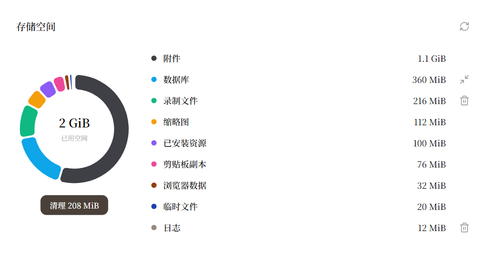
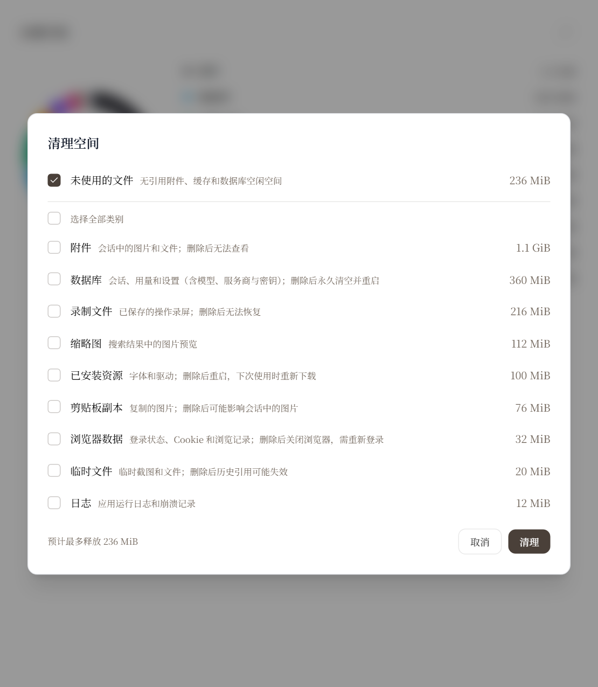
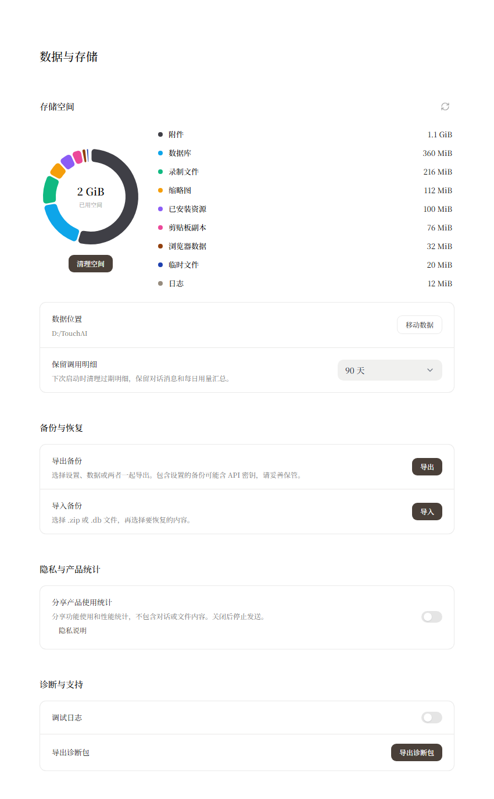
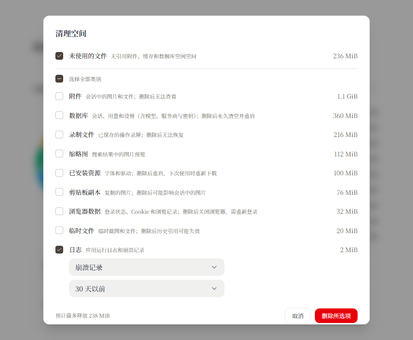
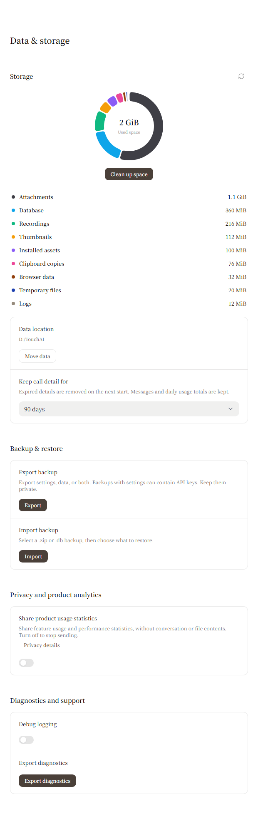

# Storage management

## Scope and authorization

The maintainer authorized the complete storage design without a separate issue or RFC, and approved one migration correcting historical turn ownership. This change reuses existing tables, indexes, attachment hashes and historical paths. It adds no separate accounting table. User content is deleted only by the explicit history controls or a confirmed storage cleanup action.

The maintainer also explicitly authorized deletion of every managed storage category, including conversations and other important data after a warning. The selection-dialog revision changes deletion behavior without adding or modifying a migration.

The maintainer subsequently requested partial cleanup ranges, consolidation of overlapping history deletion controls into storage cleanup, and moving the data location. This authorizes those deletion and relocation behaviors without a schema migration. Relocation must stage and verify an independent copy, rewrite managed path references in the copied database, switch the root only after success, and preserve the source on failure.

## Acceptance scenarios

- Given the storage overview, when the user chooses Clean up space, then one dialog lists every managed category with checkboxes; the overview has no per-category maintenance buttons.
- Given the cleanup dialog, when the user reviews any item before selecting it, then gray text beside its name explains its contents and any material deletion consequence; low-risk items have no extra warning.
- Given Data & storage settings, when the user opens the page or searches settings, then the duplicate data statistics block and its search result are absent; the storage overview and history controls remain available.
- Given the data settings page, when the user reads from top to bottom, then storage and retention, backup and restore, privacy, and diagnostics are grouped by purpose; history deletion is part of storage cleanup and model catalog updates live under Providers & models.
- Given storage cleanup, when the user selects Database, then they can choose conversations, messages, call details, or all local data; consequences appear with the choice before explicit confirmation.
- Given files with different modification dates, when the user chooses an older-than range, then only files within that range are deleted; invalid ranges are rejected and recent file references remain valid.
- Given a new data location, when the user confirms and restarts, then all managed directories and their path references move together; occupied destinations, overlapping paths, redirects, insufficient space, and copy failures leave the original usable.
- Given the product analytics choice, when the user reads its description, then a two-sentence summary explains what is shared and how to stop sharing; the full privacy disclosure is available without changing consent.
- Given a settings search for a moved or consolidated action, when the user selects its result, then it leads to a visible control in the owning section.
- Given selected categories contain personal data, when the user reviews the selection, then the dialog describes the loss and still allows explicit deletion. Database deletion clears conversations, usage and local configuration, then requires a restart; it never deletes the live SQLite file or schema.
- Given referenced attachments or managed screenshots are explicitly selected for deletion, when cleanup completes, then their managed bytes and matching file references are removed without erasing unrelated conversation text or touching external originals. Subsequent backups remain valid.
- Given browser data or installed resources are selected, when cleanup starts, then the corresponding managed runtimes stop and their writers cannot race the deletion. Files outside the measured managed roots remain untouched.
- Given unused-file cleanup and overlapping categories are selected together, when the estimate is shown and cleanup runs, then each managed file is counted and processed once. Database free-space recovery runs inside the same maintenance operation.
- Given any selected operation partially fails, when the user sees the result, then committed deletion, remaining failures and restart requirements remain visible.
- Given a storage scan, when the user opens the overview, then a compact list shows each category and its occupied size. Inspecting a category shows its share and file count, including for zero-byte files.
- Given a user navigates by keyboard, when they open cleanup, then the dialog traps focus, exposes labeled checkboxes and allows cancellation before deletion starts.
- Given a category supports maintenance, when the user selects its name in the overview, then the ring shows its usage. Deletion choices and the combined estimate appear in the cleanup dialog.
- Given a backup containing settings and conversation data, when the user selects either or both during export or restore, then the selected settings, conversations, usage and managed attachments travel with their respective scope. Restoring just settings preserves local history and its files; restoring just data preserves local configuration.
- Given two conversations share an attachment, when one conversation is removed, then the other conversation's attachment and original image remain readable.
- Given a user changes an external source file after sending it, when the conversation is reopened, then the saved attachment still contains the bytes captured at send time.
- Given identical immutable app-owned bytes exist under two necessary paths, when storage is optimized, then the paths share a physical file where supported; unsupported filesystems still provide independent readable copies.
- Given a draft, agent task, import or backup is active, when cleanup is requested, then cleanup cannot remove its files or interleave with its database writes.
- Given unused app-generated clipboard files, thumbnails and temporary artifacts, when safe cleanup is confirmed, then those files are removed without deleting user originals, active browser profiles, saved recordings or current drivers.
- Given a path is a symbolic link, junction or other reparse point, when storage is scanned or cleaned, then it is not followed outside the managed root.
- Given several paths are hard links to one file, when usage is displayed, then the physical file is counted once and removing only one name is not reported as releasing its contents.
- Given file deletion fails, when cleanup completes, then successfully deleted items and failed items are reported separately and another cleanup can reclaim leftovers.
- Given the user explicitly deletes history, when deletion commits, then content snapshots and unreferenced attachments do not survive unintentionally, while durable usage totals are preserved.
- Given the database has free pages, when the user requests database compaction, then valid content is unchanged; active transactions or insufficient free disk space are refused without modifying user data.
- Given a full backup is exported and restored into a different application root, when history is opened, then database content, managed attachments and retained app-owned originals are restored without requiring the source installation. Each content object is archived once; a backup is never a hard link to live data.
- Given a legacy `.db` backup, when the user imports it, then the existing import behavior remains supported.
- Given an older browser screenshot is referenced by history or input recovery, when another screenshot is captured or the browser stops, then the original remains readable; only reference-aware storage maintenance can reclaim it.
- Given a screenshot directory is replaced by a symlink or junction, when capture or cleanup is attempted, then no external file is written, modified or deleted.
- Given an unsent draft is temporarily replaced while browsing input history, when cleanup is requested, then its recoverable attachments stay protected until the draft is discarded or the owning view closes.
- Given non-zero turn and attempt usage in a backup, when the restore includes Data, then token, cost, latency and daily aggregates are preserved and repeated imports count each live turn once.
- Given the clipboard changes before maintenance starts, when cleanup obtains exclusive access, then protection is read from that current snapshot rather than a pre-lock snapshot.
- Given a platform data directory has redirected ancestors but no redirects inside the managed cache, when publishing, scanning, compacting or backing up, then existing logical paths keep working without relaxing the managed subtree boundary.
- Given committed database changes remain in WAL or database files are compressed, when compaction completes, then before/after usage includes physical allocation for the database and sidecars, not just the main file's logical length.
- Given a completed or running turn uses a model, when that model or its provider is deleted, then the turn, attempts, content snapshots and usage survive with a null model reference.
- Given model/provider configuration is renamed after a turn started, when history or usage is read, then the original name snapshots remain available; new turns capture the new names.
- Given a database using the previous schema contains attempts, when the approved migration rebuilds the turns table, then attempts, row IDs, content, counters and foreign-key integrity remain unchanged.
- Given a model-deleted turn is exported or restored, when either backup format/import mode is used, then detached turns retain their names and usage without a missing-model join dropping them.

## Ownership and invariants

Rust owns filesystem publication, physical identity accounting, cleanup and the maintenance exclusion gate. Frontend services coordinate draft/task activity through NativeService. Database runtime operations share a read/exclusive maintenance gate so cleanup, import and compaction cannot race a transaction. Files are prepared before SQLite write transactions.

Hard links are not snapshots and are never used to adopt external user files. Published attachment content is immutable: no truncate-and-write of an existing hash path. A hard link is permitted only between managed, verified, byte-identical files within one trust domain; paths exposed as editable outputs need independent copies. Original and normalized images remain distinct when their bytes differ. Business references, not link counts, determine whether content may be removed.

The default unused-file cleanup processes recognized files under managed roots, protects attachment rows and referenced app-owned originals, and recovers reusable database space. Explicit category selection removes files in the chosen category and range, including referenced files, after displaying the consequences. The default range is all time; file categories other than browser data and installed resources also offer files modified more than 7, 30 or 90 days ago. Logs additionally distinguish application activity and crash records. Both paths reject reparse points and unknown filesystem identities, scan before mutation, and run under the storage and database maintenance gates. Native removal still validates every file's physical identity.

Explicit file deletion prunes attachment associations and matching metadata paths in messages, prompt snapshots and recovery attempts while retaining conversation text. Removing an app-owned original alone updates its attachment row to the saved cached copy. JSON processing uses bounded pages and depth/node budgets. Database deletion runs a transaction that clears user rows without altering the schema or migration history, compacts the remaining database, then closes the shared pool to prevent stale windows from rewriting deleted data before restart. Font and driver deletion also requires restart. Filesystem or compaction failures after committed metadata changes remain visible in the result.

Managed originals restored under `cache/originals` count toward Attachments and can be deleted with that category. When Database and Unused files are selected together, the unused-file plan uses references from before the reset; previously referenced attachments are not silently added to the selection. Partial deletion requiring restart stays on screen with a Restart action so the failure details remain reviewable.

Full backups use an independent compressed archive, a versioned manifest and SHA-256 verification. Import validates paths, entry types, sizes and hashes before publication. Restored files are independent copies, not hard links to archive blobs or to another restored path. Old database imports remain available. Cache format or backup manifest changes do not change database structure.

The ring shows total physical usage. Its legend lists every category once, largest first, with its occupied bytes. Hovering or selecting an occupied category shows its size, share and file count in the ring; the category tooltip also exposes the count and share. Empty categories stay in the list, including files that occupy zero bytes.

The button under the ring reads Clean up space. A shadcn/vue-style Dialog with Reka UI Checkbox primitives contains the unused-file option, every measured category and select-all. Each name is followed by a gray description of its contents and any material deletion consequence, visible before selection and associated with the checkbox for assistive technology. Low-risk items have no extra warning, and there is no separate warning block at the bottom. Database offers conversations, messages, call details or all local data and settings. Only the full database reset and installed-resource selections require restart. Refresh remains an icon; the category rows have no maintenance icons. Typography inherits the Settings window's Source Han Serif font. Data & storage no longer repeats the session, message and turn counts already covered by Usage.

Current settings and partial cleanup (real Vue components, synthetic storage data, product font):

Component references: [shadcn/vue Dialog](https://www.shadcn-vue.com/docs/components/dialog) and [Checkbox](https://www.shadcn-vue.com/docs/components/checkbox). Both patterns reuse the installed Reka UI dependency.

## Settings organization and product references

The layout follows the actions users take: inspect and reclaim space, choose its location and retention, back up or restore, decide whether to share product statistics, and export diagnostics for troubleshooting. Model catalog maintenance belongs with providers and models. Crash deletion and the three history deletion buttons are consolidated into the cleanup dialog.

- [Chrome: delete browsing data](https://support.google.com/chrome/answer/2392709?hl=en) uses one deletion flow with data types and a time range. TouchAI applies that pattern to file categories; its ranges mean older files, so they are labeled explicitly as “Older than”.
- [VS Code: telemetry](https://code.visualstudio.com/docs/configure/telemetry) separates the consent control from detailed explanations of collection. TouchAI keeps a two-sentence summary and an adjacent full privacy disclosure.
- [Obsidian: manage vaults](https://help.obsidian.md/manage-vaults), verified against its [official documentation source](https://github.com/obsidianmd/obsidian-help/blob/master/en/Files%20and%20folders/Manage%20vaults.md), exposes moving a data folder and requires its active window to close. TouchAI schedules relocation for the next restart before opening its database and log writers.

## Moving the data location

The native directory picker selects an empty destination. Confirmation shows its path and explains the restart. Scheduling holds the storage maintenance gate, validates non-overlapping physical paths and sufficient space, and persists a pending destination. Cancelling before restart removes only that pending choice.

A small `data-location.json` and a lifetime profile lock remain in the original platform data directory. Startup waits at most five seconds for the previous process to release that lock, so Tauri's spawn-before-exit restart cannot race relocation. The database, logging and other writers start after the location is resolved. A missing active database stops initialization rather than creating an empty profile.

Migration copies `data`, `cache`, `logs`, `assets`, `computer-use` and app-local `skills` into a private staging directory on the destination volume. External originals, separately configured external driver directories, shared home-directory skills and Tauri's platform WebView state stay in their existing locations. Copying uses existing bounded, redirect-rejecting filesystem helpers, SHA-256 checks and physical identity rechecks; hard links are recreated only between destination copies of an existing alias. File permissions, modification times and empty directories are preserved. There is no database schema change.

The copied SQLite database passes integrity checking; managed absolute paths in attachment metadata, settings and recovery records are rewritten in a transaction, then WAL is checkpointed. Message text and external paths are preserved. Both the physical and platform logical source prefixes are handled. Publishing the destination precedes atomically persisting the active pointer; only then are verified source files removed. Copy, validation and pre-switch failures retain the source. Cleanup failure after switching reports the old directory while using the new data.

The relocation coordinator is application code because a generic directory-copy library does not own SQLite references, the profile lock, physical alias preservation or the commit boundary. It reuses `tempfile`, `sqlx`, SHA-256 and the existing storage filesystem utilities. It conservatively requires twice the logical source size plus 64 MiB free on the destination, refuses redirects within managed directories, and bounds traversal to 100,000 entries. A process or power interruption can leave staging or published copies before pointer commit; these are not automatically swept because ownership must be established before deletion. The original pointer remains authoritative. The old app version does not understand relocation, so downgrade requires moving data back or restoring a backup.

Export and restore each offer two selections, Settings and Data. Settings includes preferences and provider, model and tool configuration, including credentials. Data includes conversations, usage, search history and managed attachments. A partial ZIP carries its content scope in a version 2 manifest and contains a newly projected database with just the selected content. The file picker reads the manifest before displaying restore choices. A full ZIP keeps the version 1 format, and legacy database-only `.db` backups remain available for both scopes together on export and selective restore on import.

## Historical reference correction

Deleting a model or provider must not delete completed or running turn history. The approved migration makes `session_turns.model_id` nullable with `ON DELETE SET NULL` and adds `model_name` / `provider_name` snapshots. It reuses the existing turns table and does not add persistent per-call accounting records or change the explicit turn-clear policy.

New turns resolve the model association and names in the same insert. Existing rows are backfilled from configuration that still exists when the migration runs. A past rename cannot be reconstructed where no original name was stored, and rows already deleted by the previous cascade cannot be recreated.

SQLite rebuilds the turns table for this constraint change. Foreign-key pragma handling runs outside the native migration transaction; otherwise the generated `PRAGMA foreign_keys=OFF` is ignored and dropping the old table can cascade into attempts. The migration preserves the AUTOINCREMENT watermark and validates foreign keys before commit. Downgrading to a writer using the previous schema is not supported; take an independent backup before upgrading.

Usage and context queries use outer joins so removed configuration cannot hide retained rows. Removed model ranking rows remain readable but cannot be selected as a current configuration filter.

Imports match existing turns by their stable task identity, which survives message/session clearing, then restore the saved session and prompt links. Prompt snapshot attachment rowids are remapped by attachment hash. The all-time trend adds frozen baseline days to live detail and uses rollup rows only for legacy days that have neither; this avoids hiding a baseline when the same day receives new requests.

## Limits

- Archives bound each blob to 4 GiB, expanded/restored content to 16 GiB, managed paths to 50,000, and manifest/usage metadata to 16 MiB. Incomplete or oversized input fails explicitly.
- A same-day import overlapping archived daily totals, or an ambiguous legacy live day, is refused rather than guessing whether usage overlaps. Deleted turn identities cannot be reconstructed.
- Old browser artifacts outside the configured cache are not swept by filename because cross-install ownership cannot be proven.
- Unmanaged external originals are never overwritten; legacy `.db` imports remain supported.
- No automatic full VACUUM runs on startup.

## Verification and budgets

Behavior tests use synthetic databases and private fixtures, never the live application database or clipboard. The implementation is checked locally with TypeScript production/test type checks, ESLint, source formatting, and targeted database/storage/settings tests. Full `pnpm test:pr`, Rust coverage, desktop E2E, a realistic large-database migration rehearsal and installed-release measurements remain CI/release evidence; they are not claimed as locally run.

For the settings/range/relocation revision, 114 frontend tests across 10 targeted suites pass (112 in the initial combined selection plus the two added location-display/diagnostics-refresh cases, with affected suites rerun after fixes). Production and test type checks, changed-file ESLint and Prettier pass. A direct `rustc --test --emit=metadata` check reused existing matching dependencies and passed for the native crate; this is not a replacement for Cargo's build-script and dependency gate. A linked native run executed all 45 storage tests: 44 passed and one fixture failed because `compact.exe` rejects a Windows canonical path. The fixture now passes a relative filename from its directory; that command was verified independently, but relinking the full suite was interrupted by insufficient disk space. The focused native executable then ran eight relocation tests and two real database migration contract tests successfully with the final source. These tests use the production SQL artifacts, connection setup, filesystem operations and relocation code.

The page and expanded cleanup dialog were checked in Chinese and English at 850 and 620 CSS-pixel content widths, corresponding to the normal and minimum settings content area. All selected options remain scrollable to the footer with no horizontal overflow. Product font bytes and painted Chinese glyphs match an independent Source Han Serif reference. The running desktop preview still uses the earlier native executable; these latest screenshots are layout fixtures, not installed-app migration evidence. Full native startup/IPC/relaunch and cross-volume interruption cases remain required in CI before release.

Before release, run `pnpm test:pr` and `pnpm test:e2e`, including Windows NTFS hard links, cross-volume/non-link fallback, open-handle deletion, reparse-point escape, interrupted publication, shared-attachment deletion, full backup restore and legacy `.db` restore. Check settings at minimum/default widths and both locales.

Measure the affected installed-release flows against baseline `c9036541` on the same device, DPI and WebView version: at most 5% P50/P95 latency and steady-state memory regression. Hashing, copying, directory scans and archive work stay off the UI thread; scans have bounded file counts and return explicit incomplete/error diagnostics.
