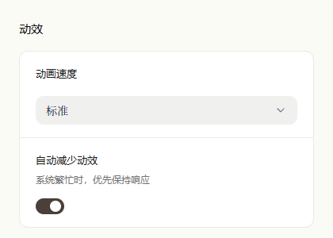
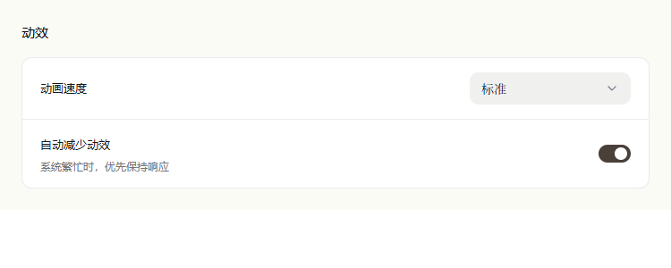

# Motion preferences UI evidence

The screenshots render the production `MotionSettingsSection`, its shared settings
controls, translations, and styles at 420px and 750px widths. The scalar settings
store is isolated with Standard speed and automatic reduction enabled. They show
the component, not the complete native settings window.

The settings behavior is covered by
`apps/desktop/tests/SettingsView/motion-settings.test.ts`; shared policy and actual
animation-engine recovery are covered by `apps/desktop/tests/motion/`.

| 420px | 750px |
| --- | --- |
|  |  |

Native window acceptance, cross-window behavior on macOS/Linux, and release latency
and memory budgets remain separate validation steps.
