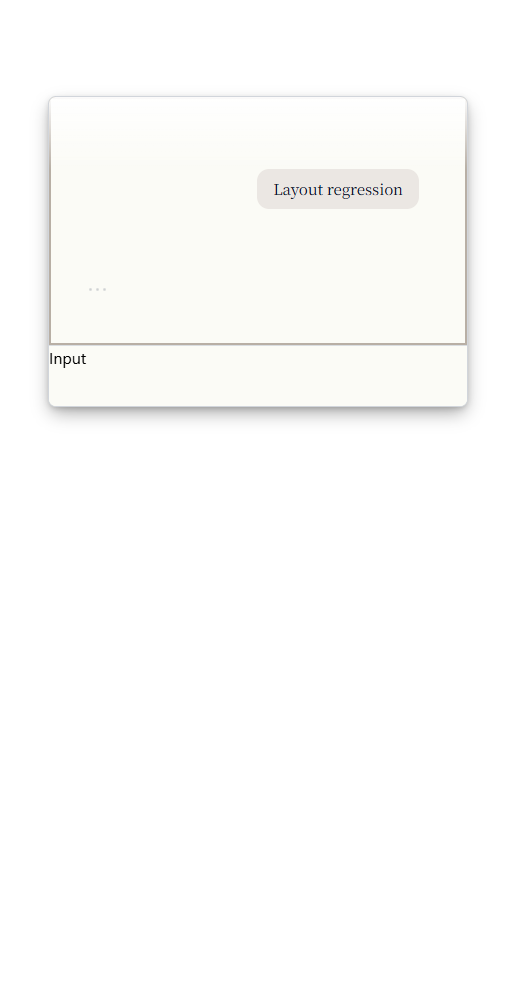
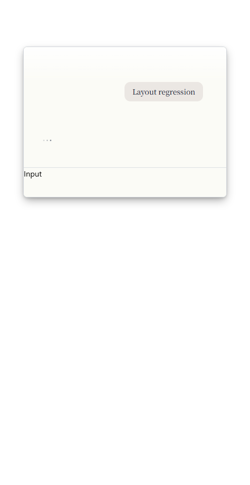
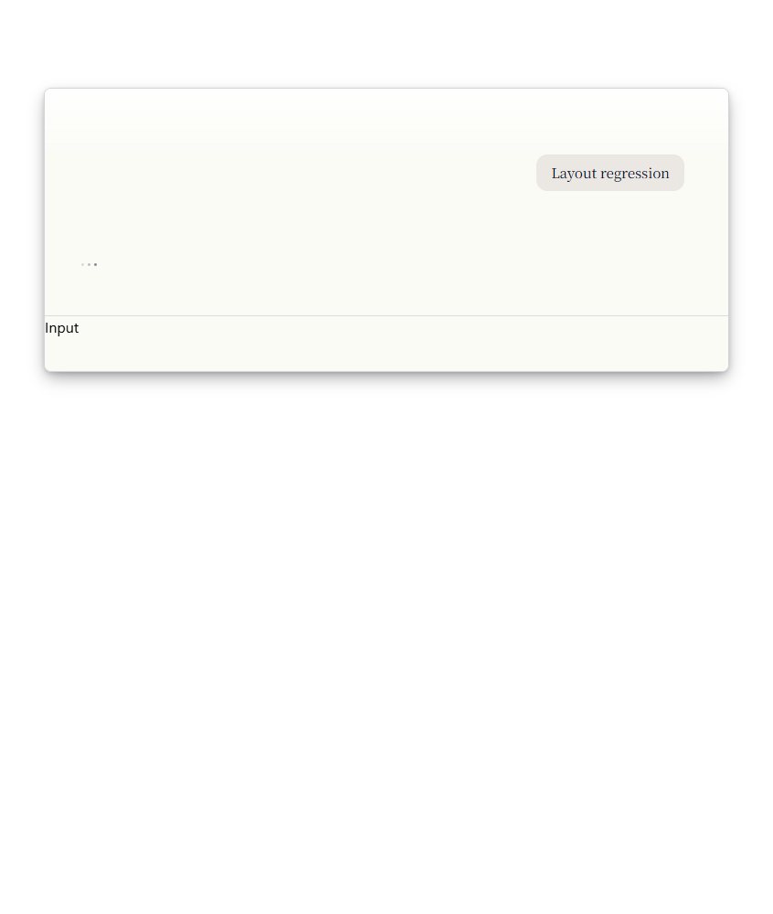
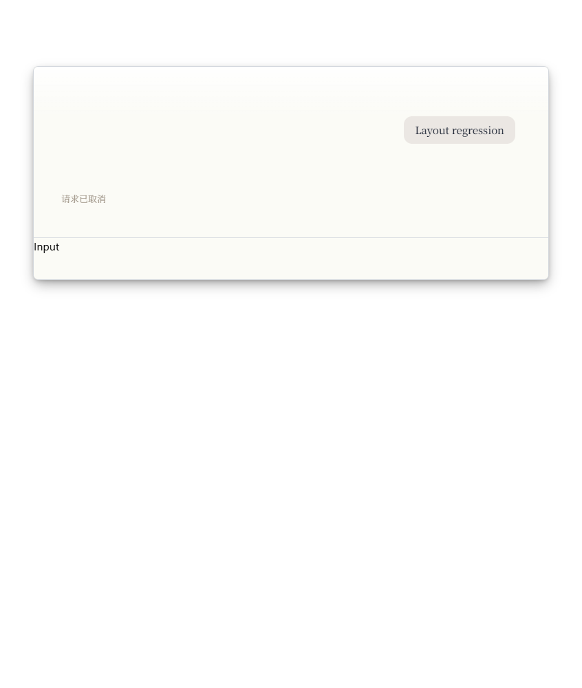

# Search window layout evidence

These browser fixtures use the production search layout, conversation components,
motion styles, and geometry owner. Native IPC, the editor, and unrelated message
renderers are isolated. They are not full desktop screenshots or evidence of native
click-through, monitor/DPI handling, or release performance.

The runner is documented in
[the layout regression guide](../../../../apps/desktop/tests/layout/README.md).
It covers 420px and 750px widths with normal and reduced motion.

## Keyboard focus

After Enter, the conversation receives focus so keyboard scrolling remains available.
The earlier viewport style painted a 2px inset ring around the entire conversation.
The updated style removes that ring; individual navigation buttons keep their focus
indicators. The browser regression checks the actual computed shadow and outline,
and verifies that focus remains on the scroll viewport.

| Before, 420px | After, 420px |
| --- | --- |
|  |  |

## Cancellation height

The pending and cancelled states retain the same card height. The editor in these
fixtures is the fixed-height test row labeled `Input`.

| Pending, 750px | Cancelled, 750px |
| --- | --- |
|  |  |

## Overlay alignment and centered expansion

[Geometry results](geometry-regression.json) record eight real-browser cases at
420px/750px, 100%/150% scale, with normal and interrupted expansion. A simulated
native boundary moves the host 24ms before acknowledging its new dimensions. The test
measures the card's screen-space center each frame and checks picker alignment,
editor clearance, hard viewport bounds, and reopening. Maximum center drift in
this run was below 0.02 physical pixels; this is a layout assertion, not a latency
or performance measurement.

The lifecycle regression separately delays the viewport and native-region
acknowledgement. The menu stays hidden until both can contain it, and a late
acknowledgement cannot revive a dismissed menu. Actual Windows hide/show and
native clipping still need desktop acceptance.
