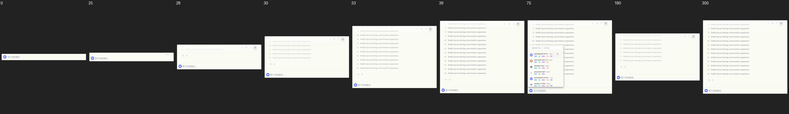
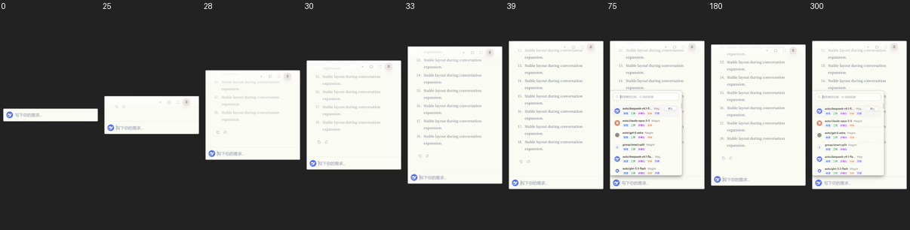

# Search window layout evidence

These browser fixtures use the production search layout, conversation components,
motion styles, and geometry owner. Native IPC, the editor, and unrelated message
renderers are isolated. They are not full desktop screenshots or evidence of native
click-through, monitor/DPI handling, or release performance.

The runner is documented in
[the layout regression guide](../../../../apps/desktop/tests/layout/README.md).
It covers 420px and 750px widths with normal and reduced motion.

## Keyboard focus

After Enter, the conversation receives focus so keyboard scrolling remains available.
The earlier viewport style painted a 2px inset ring around the entire conversation.
The updated style removes that ring; individual navigation buttons keep their focus
indicators. The browser regression checks the actual computed shadow and outline,
and verifies that focus remains on the scroll viewport.

| Before, 420px | After, 420px |
| --- | --- |
|  |  |

## Cancellation height

The pending and cancelled states retain the same card height. The editor in these
fixtures is the fixed-height test row labeled `Input`.

| Pending, 750px | Cancelled, 750px |
| --- | --- |
|  |  |

## Overlay alignment and centered expansion

The browser geometry runner covers 420px/750px, 100%/150% scale, with normal and
interrupted expansion. The native boundary keeps the viewport stable and delays
acknowledgement by 24ms. The test measures the card's screen-space center each frame
and checks picker alignment, editor clearance, hard viewport bounds, and reopening.
The older [geometry results](geometry-regression.json) describe the earlier moving-host
implementation; they are retained as historical evidence, not current acceptance.

The lifecycle regression separately delays the viewport and native-region
acknowledgement. The menu stays hidden until both can contain it, and a late
acknowledgement cannot revive a dismissed menu.

## Native follow-up, 2026-11-07

The current Rust application was rebuilt against its matching cached dependency
artifacts and run with an isolated test data root. This is a debug native probe,
not a release build or the full `pnpm test:e2e` gate.

- Reopen followed by Ctrl+P pin/unpin retains native visibility. The previous binary
  failed this same probe because raw Win32 show/hide left Tao's visibility flags stale.
- All nine default search shortcuts reached their expected effects using trusted CDP
  DOM key input in the native WebView. Repeat suppression and maximize/restore passed.
  Physical Windows accelerator input remains a separate acceptance item.
- Closing a picker while starting a new session previously cancelled the fallback
  fold. A failing geometry regression and the native Ctrl+N reproduction now pass;
  content measurements wait for the current transition to settle. A second regression
  delays the native constraint response beyond the fold duration; constraints now
  finish before the animation starts.
- Window command integration tests: 19 passed against the rebuilt application library.
- Desktop Duplication recordings at 150% scale cover default and minimum widths,
  expansion, collapse, reopen, and the first picker after hide/show. Every captured
  frame was measured for card edges; visible center deviation was at most 0.5 physical
  pixels. Expansion frames were also inspected visually. Background content is removed
  from the attached evidence; timing and pixels inside the card are preserved in the
  source recording. The exported video uses uniform 60fps and is not a latency trace.

[Default-width recording](native-followup-default.mp4) ?
[Minimum-width recording](native-followup-minimum.mp4)

Actual pointer dragging to the screen edge, physical shortcut repeat/release ordering,
cross-screen mixed DPI, and release cold/warm P50/P95 and memory budgets remain open.
The Windows Computer Use helper was unavailable (`native pipe`, OS error 2), and the
repository desktop E2E gate could not establish its WebDriver session. The normal
`cargo check --all-targets` subsequently passed with incremental compilation disabled
after the initial disk-space failure. These recordings
do not certify those paths or long-hidden wake latency.
